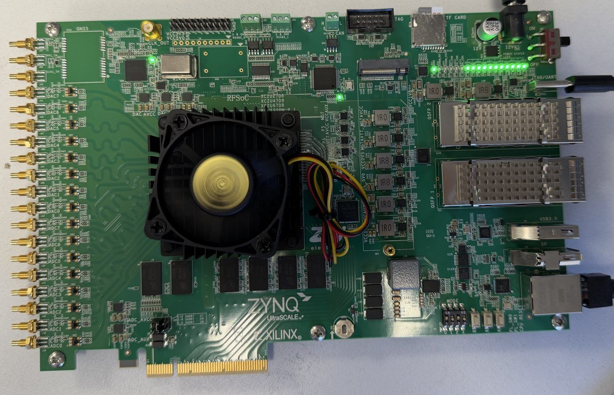

# HamGeek ZU67DR PYNQ

PYNQ 4.0.0 image for the HamGeek XCZU67DR PCIe V1 card (XCZU67DR-2FSVE1156I). The image uses Ubuntu 24.04, Vivado 2025.2 and AMD EDF.

The HamGeek listing covers the ZU27DR, ZU47DR and ZU67DR family. This repository targets the revision 2.1 card fitted with the XCZU67DR. [HamGeek product listing](https://www.hgeek.com/products/xczu27dr-rfsoc-pcie-rf-wireless-development-board-for-zynq-onboard-gnss-module-support-pps-output?variant=47644053504165)



## Download and boot

The [stable release](https://github.com/Seguar/HamGeek-ZU67DR-PYNQ/releases/tag/v4.0.0-zu67dr.1) carries the standard and 8 GB image bytes from RC2. Verify the archive against `SHA256SUMS` and the expanded file against `RAW-SHA256SUMS`. The standard image needs **8,266,973,184 bytes**. The compact image needs **7,645,691,904 bytes** and fits the **7,818,182,656-byte eMMC** on the tested board. Check the media capacity before writing.

Set SW1 with power off. Positions below follow poles 1–4. Up (ON, marked “1”) sets the bit and pole 1 is MODE bit 0.

| Boot medium | MODE[3:0] | Pole 1 | Pole 2 | Pole 3 | Pole 4 |
| --- | --- | --- | --- | --- | --- |
| microSD (SD1) | `0101` | Up | Down | Up | Down |
| eMMC (eMMC18) | `0110` | Down | Up | Up | Down |

The first eMMC attempt selected PJTAG1 (`1001`) because the switch polarity in the early instructions was reversed. See the [bring-up instructions](bring-up.md) for console and boot checks.

The [RC2](https://github.com/Seguar/HamGeek-ZU67DR-PYNQ/releases/tag/v4.0.0-zu67dr.1-rc2) and [RC1](https://github.com/Seguar/HamGeek-ZU67DR-PYNQ/releases/tag/v4.0.0-zu67dr.1-rc1) pre-releases are superseded.

## Board revision 2.1 findings and resolutions

### ADC_AVCC at TP16

TP16 measured **0.93 V**, below the XCZU67DR recommended **0.980–1.040 V** range. The released ADC utilities require an in-range measurement. U82 (TPS74901) sets ADC_AVCC according to `Vout = 0.8 V × (1 + R_top/R_bottom)`. The V1 schematic shows 750 Ω over 4.7 kΩ, which predicts 0.928 V. The following rework is calculated and awaits hardware verification. Hardware modifications are at the owner's risk. [AMD DS926](https://docs.amd.com/r/en-US/ds926-zynq-ultrascale-plus-rfsoc/Recommended-Operating-Conditions) · [TI TPS74901](https://www.ti.com/lit/ds/symlink/tps74901.pdf)

1. Power off and disconnect the card. On revision 2.1, check R610, R487 and R485 next to U82. Use continuity and resistance measurements to identify the output-to-FB resistor (R_top) and confirm the FB-to-ground resistor (R_bottom) is 4.7 kΩ before selecting a replacement.
2. Replace R_top with a 1% resistor matching the fitted pads (0402 or 0603). With a 4.7 kΩ bottom resistor, 1.24 kΩ (E96) gives 1.011 V nominal and 1.21 kΩ gives 1.006 V. Leave U80 (DAC_AVCC) at its measured, in-spec 0.925 V.
3. Power up with a current limit. Verify U82 VIN (nominal 1.2 V) and BIAS (nominal 5 V). The 5 V bias meets the device's 2.7 V minimum and provides more than 1.6 V above the target output. Measure **1.00–1.02 V at TP16** before running RF tests.

### DAC_AVTT at TP17

TP17 measured **2.5 V**. Use the fixed **20 mA** DAC setting on this board. The vendor's 40 mA VOP example requires 3.0 V. For VOP or fixed 32 mA operation, a candidate hardware modification is to set U78 (TPS74801) to 3.0 V. With power disconnected, identify and measure the fitted feedback divider near R703/R482/R707. Select the top resistor for the measured bottom resistor using `R_top = R_bottom × (3.0/0.8 − 1)`. Verify the result at TP17 on current-limited power before changing DAC mode. Check the supplies under load. VCC3V3 gives 0.3 V nominal input headroom, and the 5 V BIAS supply gives 2 V above the output. Confirm both meet dropout requirements at the intended load. This rework also awaits hardware verification. [AMD RF-DAC VOP compatibility](https://docs.amd.com/r/en-US/pg269-rf-data-converter/VOP-Backwards-Compatibility-Gen-3/DFE) · [TI TPS74801](https://www.ti.com/lit/ds/symlink/tps74801.pdf)

| Symptom or finding | How to resolve |
| --- | --- |
| RC1 sees microSD as write-protected and fails to mount the ext4 root (EROFS). The socket lacks a write-protect line. | Use the stable image, or add `disable-wp` to SDHCI1 and deploy the rebuilt Linux DTB. The patched DTB booted on the tested card. |
| LMK04828 PLL1 cannot lock (U47 is a fixed 19.2 MHz OCXO). | Use the [J35 external device clock](#external-device-clock-j35) to follow an external reference. |
| Incorrect RF-ADC Nyquist parity degrades calibration and SFDR. | Select 1 for an odd input zone or 2 for an even zone. Read back the setting and let calibration settle. [ADC00 Nyquist helper](tests/adc-nyquist/) |
| The tested 8 GB Kioxia eMMC showed prior use. | Back up its contents first. Check the actual capacity, then use the compact release image if it fits. |
| Earlier r2/r4 rate-sweep overlays could hang during AXI access. | Use only matched r5 bundles. Run status-only before RFDC setup and capture. [Rate-sweep instructions](tests/adc-rate-sweep/) |
| The tested board lacks a battery-backed clock. | Check `timedatectl status` after boot. If NTP is blocked, set UTC from a trusted source before TLS, package installation or timestamped measurements. |

### DAC2 / J48

Visual and mechanical inspection found a cracked ferrite core in DAC2 balun **U61**. Reduced magnetizing inductance explains the high-pass-shaped loss. A scope, spectrum analyzer and direct RF loop measured the output deficit. Direct loop peaks were about 29 dB low at 500 MHz and 37 dB low at 100 MHz. At 1 GHz the mechanical probe recorded a brief +22.62 dB recovery on DAC2 while the DAC1 reference stayed within 0.23 dB. Replace U61 with a **Mini-Circuits TCM2-63WX+** and rerun the DAC2-to-ADC2 loopback. [Bring-up report](https://seguar.github.io/hamgeek-zu67dr-bringup/#dac2-verdict)

## PL DDR4

The vendor PDF's PL DDR4 pinout is incorrect for the tested card. Its build failed memory calibration. The [corrected pinout](docs/pl-ddr4-pinout.md) was recovered by boundary scan on the sister XCZU47DR and verified on the XCZU67DR. The PL memory is **one x32 DDR4-2400 interface, 2 GiB**. DQ, DQS and DM are in bank 66. Command and address are in bank 65, with **RESET_n on AE16**. The corrected build calibrated and passed 31 addresses in each polarity plus five full 2 GiB passes with zero mismatches.

## Clock and SYSREF input options

J35 (CLK1_IN) is a 50 Ω terminated, AC-coupled input to LMK04828 CLKin1. J32 (CLK_OUT) carries LMK SDCLKOUT5, nominally 245.76 MHz in the 245.76 MHz plan. J64 (PPS_IN) reaches a PL pin. The unfitted J66 SMA, J67 selection jumper and U48 TCXO footprints provide a path to LMK CLKin0 on the net named SYSREF_IN. PS GPIO 26 drives LMK SYNC.

**Measured on one card.** The onboard 3000 MHz VCO plan supported MTS at 2.5 and 2.9375 GS/s. The 250 MHz reference plan uses 6.25 MHz SYSREF at 2.5 GS/s and 0.78125 MHz SYSREF at 2.9375 GS/s. The 245.76 MHz reference plan uses 3.84 MHz SYSREF and supported MTS at 2.94912 GS/s.

**External timing options awaiting hardware verification**

| Objective | Candidate configuration |
| --- | --- |
| Supply or trigger SYSREF | Populate J66/J67 and configure the CLKin0 path for external SYSREF, or configure the LMK to generate SYSREF on a SYNC event from PS GPIO 26. |
| Timestamp PPS | Capture J64 edges in the PL and timestamp them against the acquisition clock. |
| Discipline the onboard oscillator to 10 MHz | Replace U47 with a compatible 19.2 MHz VCXO and verify PLL1 tuning range, loop response and lock. This rework is unverified. |

## External device clock (J35)

Feed a **1.5 GHz CW clock** into J35 to run LMK04828 CLKin1 in Fin distribution
mode with both PLLs off. U47 is a fixed 19.2 MHz OCXO. A full PLL1 DAC sweep
moved its frequency by **<0.002 ppm (MEAS)**, so PLL1 cannot steer it. J35
cannot feed PLL2, whose reference input is OSCin. J66, J67 and U48 are
unfitted on revision 2.1. A source locked to a lab 10 MHz reference lets
the card follow that reference without rework. The VCXO alternative in
[Clock and SYSREF input options](#clock-and-sysref-input-options) is unverified.

Use a low-jitter sine source with modulation off. The Fin input requires
**0.25–2.0 Vpp at the LMK pin** and **≥0.15 V/ns** slew (20–80%), with
**≥0.5 V/ns** recommended (**D**). Start with **+3 dBm at the J35 cable end**
measured into 50 Ω (0.89 Vpp **CALC**). The pin swing depends on the board's
input transfer. The passing bench run used a +3 dBm generator setting before
the splitter and had no cable-end calibration. [TI LMK04828, §7.5](https://www.ti.com/lit/ds/symlink/lmk04828.pdf#page=12)

The r5 plan uses **Fin/6 = 250 MHz** for the references and **Fin/240 =
6.25 MHz** for SYSREF (**CALC**). All LMK outputs retain the stock
frequencies, formats and routing. The associated rates are 10 GS/s DAC,
2.5 GS/s ADC and nominally 312.5 MHz fabric. See the
[register and clock notes](tools/ext-clock-j35/CLOCK_NOTES.md).

### Status-only, then warm reloads

On the board, stop other PL applications and DAC playback. With the source
RF off, connect it to J35 and connect an analyzer or a suitable scope to
J32. Set the source and enable RF. Extract
[`rowtiming-r5-20ma.tar.xz`](https://github.com/Seguar/HamGeek-ZU67DR-PYNQ/releases/download/v4.0.0-zu67dr.1/rowtiming-r5-20ma.tar.xz).
From the repo root, set `BUNDLE` to the extracted directory and `TP16_V`
to the measured ADC_AVCC (0.980–1.040 V for the MTS test). Confirm DAC_AVTT
at TP17 is 2.5 V.

```bash
. /etc/profile.d/xrt_setup.sh
j35() {
  sudo -E /usr/local/share/pynq-venv/bin/python -B -u \
    tools/ext-clock-j35/run_ext_clock.py "$@"
}
j35 run --bundle "${BUNDLE:?Set BUNDLE to the extracted directory}" \
  --confirm-j32 --status-only --output j35-status &&
j35 run --bundle "$BUNDLE" --confirm-j32 --adc-avcc "${TP16_V:?Set TP16_V}" \
  --cycles 10 --output j35-warm
```

At each prompt, confirm a stable **250 MHz at J32** after Fin programming.
Type `250MHz` only after observing the clock. Press Enter to abort. For an
automated J32 check, replace `--confirm-j32` in both commands with
`--analyzer-host "$ANALYZER_HOST"`. `--analyzer-port` sets the raw SCPI
TCP port. See the [tool instructions](tools/ext-clock-j35/) for analyzer
settings and per-cycle results.

### Return to the onboard clock

The runner restores the stock 3000 MHz internal VCO profile and checks
PLL2 lock on exit, including after an abort. Keep the J35 source on until
stock PLL2 lock is confirmed. To restore explicitly, run:

```bash
j35 restore --bundle "$BUNDLE"
```

### Bench results

| Evidence | Result |
| --- | --- |
| **MEAS** · 1.5 GHz warm reloads | **10/10 passed**. Fabric 312.36–312.50 MHz, SYSREF 6.2493–6.2500 MHz, stream flags `0xf`. |
| **MEAS** · RFDC multi-tile sync | DAC latency 432/432 and ADC 436/436 on every reload, zero offsets. |
| **MEAS** · DAC7 phase | 1.44° peak-to-peak over 30 captures referenced to the same source (**CALC** ≈2.7 ps at 1.5 GHz). |
| **MEAS** · 3 GHz | No 250 MHz at J32, with a splitter at +3 dBm generator setting or with a direct feed at +3 and +6 dBm generator settings. |

The bench card measured 0.93 V at TP16 during these runs. Cold power-cycle
repeatability, the cause of the 3 GHz failure, and the high-frequency J35
transfer are open. The included 3 GHz profile is experimental.

## Measured r5 ADC rate sweep

Each run on the bring-up installation captured **8 × 65,536 samples** with MTS. ADC0 received a 150 MHz tone at −6 dBm. The generators were unfiltered and ADC_AVCC measured **0.93 V**, outside the recommended range.

| Sample rate (GS/s) | MTS latency (tiles 0/1) | ADC0 SNR relative to full scale (dB) | ADC0 NSD (dBFS/Hz) |
| ---: | ---: | ---: | ---: |
| 2.5 | 80/80 | 61.5 | −152.52 |
| 2.9375 | 76/76 | 61.0 | −152.63 |
| 2.94912 | 76/76 | 61.0 | −152.65 |

Measured crosstalk was ≤ −73 dBc relative to the driven channel at the tested tones (150 and 400 MHz). The largest coupled tone was on ADC2 with ADC1 driven at 400 MHz.

## Home-bench results

- Eight DAC-to-ADC loops were measured with ADC_AVCC at 0.93 V. Median absolute agreement with the lab prediction was 0.34 dB. Healthy-loop phase span was at most 0.131° at 100 MHz over ten warm reloads.
- PCIe-edge GTY lanes 0–3 passed 60 s of PRBS31 at 7.8125, 10, 10.3125, 15.625 and 20 Gb/s per lane using the Si5341 reference and an unpowered fixture. The 20 Gb/s soak stopped after 111.1 s with one lane 3 error.

### Low-frequency loopback

The seven healthy DAC-to-ADC loops detected tones down to **22.6–27.7 kHz** individually. The lowest common passing tone was **29.1 kHz**. The test used RowTiming r5, 10 GS/s DAC at 0 dBFS, 2.5 GS/s ADC and ADC_AVCC 0.93 V. The tones passed when every repeat cleared local noise and the playback-off control by at least 10 dB. Below the 76.294 kHz native waveform limit, repeat-table playback and phase-aligned ADC captures covered two periods. Each result includes both baluns and the cables.

| Loop | Lower −3 dB (kHz) | Lower −10 dB (kHz) | Lowest detectable (kHz) |
| --- | ---: | ---: | ---: |
| 0 | 215.0 | 113.1 | 25.4 |
| 1 | 189.4 | 116.1 | 23.5 |
| 2 (cracked U61) | 76,479.4 | 26,749.9 | 2,800.0 |
| 3 | 208.5 | 99.4 | 26.5 |
| 4 | 207.3 | 115.8 | 27.7 |
| 5 | 202.1 | 112.9 | 24.4 |
| 6 | 188.6 | 104.7 | 24.4 |
| 7 | 190.8 | 102.8 | 22.6 |

The crossings are interpolated relative to each loop's own 100 MHz level. The detection floor depends on the capture window and noise. [Sweep details and plots](https://seguar.github.io/hamgeek-zu67dr-bringup/#low-frequency-limit)

[Interactive bench report](https://seguar.github.io/hamgeek-zu67dr-bringup/) · [Measured-characteristics datasheet (PDF)](https://seguar.github.io/hamgeek-zu67dr-bringup/HamGeek-ZU67DR-measured-characteristics-v1.3.pdf)

## Hard DFE mixer and channel filter

The [DFE notebook](notebooks/dfe-mixer-ccf.ipynb) uses DAC0/J44 and ADC0/J36 to measure frequency translation and channel rejection. The [overlay and installation guide](overlay/dfe-mixer-ccf/README.md) includes the hardware interface, clock setup and build steps.

## RF and DDR test tools

Download the matching archives from the [stable release](https://github.com/Seguar/HamGeek-ZU67DR-PYNQ/releases/tag/v4.0.0-zu67dr.1). Verify each archive against `SHA256SUMS` and the extracted files against the bundle's `artifacts.sha256`.

- [ADC00/J36](overlay/README.md) captures 32,768 real samples at 2.4576 GS/s and remains available from its [overlay prerelease](https://github.com/Seguar/HamGeek-ZU67DR-PYNQ/releases/tag/adc00-v0.1.0-rc1).
- [r5 ADC rate-sweep overlays](tests/adc-rate-sweep/) cover 2.5, 2.9375 and 2.94912 GS/s, with status checks before RFDC setup and capture.
- `rowtiming-r5-20ma.tar.xz` uses the fixed 20 mA DAC mode and includes a status-only entry point.
- [ADC Nyquist helper](tests/adc-nyquist/) reads or sets ADC00 Nyquist parity and calibration mode.
- `pl-ddr4-r7-zu47pinout.tar.xz` uses the [corrected pinout](docs/pl-ddr4-pinout.md). The historical RC2 vendor-map overlay failed calibration.
- `pcie-edge-gty-eye.tar.xz` includes the five eye-enabled builds that passed 60 s of PRBS31. The 20 Gb/s build is marginal.

## Validation

The compact image passed read-back, cold boot and clean reboot on eMMC. First-boot growth left about 169 MiB free. PYNQ and Overlay imported and Jupyter responded. RowTiming r5 passed fabric, SYSREF, stream and MTS checks with playback disabled. PL DDR4 r7 verified 2 GiB with zero mismatches. PCIe-edge GTY passed 60 s of PRBS31 on lanes 0–3 at 15.625 Gb/s per lane with zero errors. Lab-local remote-access packages were added on the tested card; they're not part of the release image.

The RF captures, DDR4 five-pass run and receiver-eye campaign used a separate microSD bring-up installation. A fresh microSD boot of these exact release bytes remains untested. The [RC1 build inputs](build-inputs.json) and [validation directory](validation/) describe the base image.
